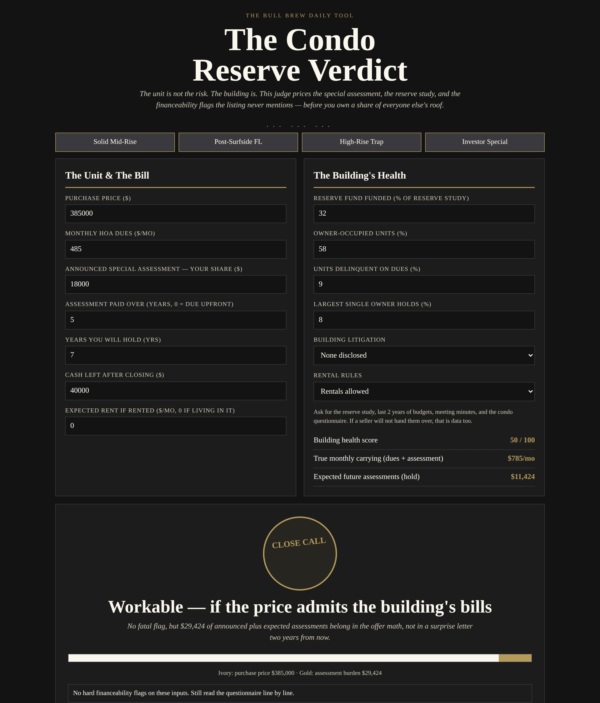

# The Condo Reserve Verdict

**Live:** https://thebullbrew.github.io/condo-reserve-verdict/
**Repo:** https://github.com/thebullbrew/condo-reserve-verdict

## What it does
A special-assessment and building-health judge for condo buyers and investors. Enter the price, dues, announced assessment, reserve funding, owner-occupancy, delinquency, single-owner concentration, litigation, and rental rules — it returns SOLID BUILDING / CLOSE CALL / ASSESSMENT TRAP / UNFINANCEABLE seals, a 0–100 building health score, true monthly carry, an honest ledger, financeability flags, the discount or credit to demand, and a reserve-funded sensitivity table. Four presets, saveable cases, copy summary. Works offline as a PWA.

## The method
You do not just buy a unit — you buy a share of the roof, elevator, facade, and every neighbour's willingness to pay. The tool prices announced assessments plus expected future assessments modelled from reserve underfunding ($24,000 per unit of 10-year capital need, scaled by the funding gap and your hold), scores building health from reserves, delinquency, occupancy, and litigation, and screens hard lender-style flags — delinquency over 15%, major litigation, and single-owner concentration over 20% — that can block financing before price matters. The discount solver turns that burden into a number to put in the offer, not a surprise after closing.

## How to run
Open `docs/index.html` in any browser, or visit the live link above. No build step, no backend, no accounts.
